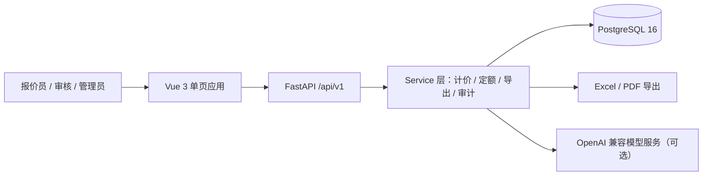

<div align="center">

# 智能化弱电报价系统

### 面向智能化弱电工程的报价与项目管理系统

从设备清单、费率套算到定额取价、报价版本与导出打印，<br>
一套报价同时给出 **两套计价口径**，并留下每一步的痕迹。

[](./apps/api/pyproject.toml)
[](./apps/web)
[](./apps/api)
[](https://www.postgresql.org/)
[](./apps/api/pyproject.toml)

**[产品定位](#产品定位)** · **[能力地图](#能力地图)** · **[技术架构](#技术架构)** · **[设计取舍](#设计取舍)** · **[工程导览](#工程导览)** · **[快速开始](#快速开始)** · **[许可](#许可)**

</div>

---

## 产品定位

智能化弱电工程（视频监控、门禁一卡通、入侵报警、综合布线、计算机网络、机房工程等）的报价不是"填几个数"，而是要把**一套设备清单**换算成**两套能对外交代的账**：

- **安装费口径** —— 设备费 + 安装费 + 辅材 + 设计费 + 质保金，按费率逐项套算，落库在 `subtotal_before_tax` / `total_with_tax`；
- **定额口径** —— 按定额子目与人工消耗量、当期人工市场信息价重算一遍，落库在 `quota_total` / `quota_total_with_tax`。

两个合计并列保留，供投标/合同与造价审核/结算分别取用；口径差异出在哪一步，是可解释、可回溯的。本仓库是这套系统的**应用代码**：后端 API + 前端单页应用 + 数据库结构。

| 核心能力 | 业务结果 |
| --- | --- |
| **两套口径并列** | 同一张单同时给出安装费口径与定额口径合计，不必事后手工对账 |
| **费率随单落库** | 报价模式、税率、各项费率是单据字段，不受"后来改了系统设置"影响 |
| **版本可回溯** | 每次保存留痕为一个版本，标记精确到秒，改了什么看得出来 |
| **成本不外流** | 客户版导出件剥离成本与毛利，字段级可见性在服务端收口 |
| **抬头可替换** | 每张单可选公司抬头（名称/地址/电话/邮箱），选中即快照进单据 |

## 能力地图

| 业务域 | 主要能力 |
| --- | --- |
| **报价单** | 明细录入、工程量与单价、安装单价就地修改、税率与各项费率、合计与毛利 |
| **计价模式** | 建单时确定：**套定额模式**（子目基价进安装单价）/ **手工人工费模式**，之后不可切换 |
| **点位模板** | 把一个点位用到的设备与安装单价（元/点）存成模板，报价时一键套用 |
| **定额与人工** | 定额子目检索与套用、工艺系数、人工市场信息价期次管理与调价测算 |
| **报价版本** | 每次保存留痕为版本、可回溯；归档单只读（费率与明细均不可改写） |
| **增项单** | 关联原单、继承原单费率与条款、独立导出 |
| **设备库** | 分类树、批量调价、软删除、操作留痕、Excel 导入与导出 |
| **客户与供应商** | 客户档案、供应商台账、询价单导入 |
| **导出与打印** | 客户版 Excel（去成本/毛利）、PDF（中文字体嵌入）、公式注入防护 |
| **权限与审计** | 角色权限矩阵、成本/利润字段级可见性、操作留痕与审计日志 |
| **AI 辅助** | 报价单/文档解析与预套定额（可选，OpenAI 兼容协议，可开启客户名脱敏） |
| **系统设置** | 公司抬头库、报价条款与数字参数、机构与用户管理 |

## 技术架构



| 层 | 选型 |
| --- | --- |
| 前端 | Vue 3.4 · TypeScript 5.4 · Vite 5.2 · Element Plus 2.7 · Pinia · Vue Router · axios · markdown-it |
| 后端 | Python ≥3.11 · FastAPI · SQLAlchemy 2（async）· asyncpg · Alembic · Pydantic v2 |
| 数据库 | PostgreSQL 16（`docker-compose.yml` 提供 `postgres:16-alpine`） |
| 鉴权 | JWT（HS256，`python-jose`）· 口令哈希 `bcrypt`（`$2b$12$`） |
| 导出 | `openpyxl`（Excel）· `reportlab`（PDF，纯 Python）· `pypdf`（读入解析） |

## 设计取舍

| 取舍 | 为什么这么做 |
| --- | --- |
| **PDF 用纯 Python 生成** | 不引入 wkhtmltopdf / Chromium / LibreOffice —— 服务器上不该为了导一张报价单去装一个浏览器；中文字形靠字体文件嵌入 |
| **Alembic 走 psycopg3** | 原先声明的 psycopg2-binary 在新版 Python 下没有预编译 wheel，装它要现场编译 |
| **直接用 bcrypt，不用 passlib** | passlib 1.7.4 与 bcrypt ≥4.1 不兼容，且 2020 年后再无发布 |
| **生产环境拒绝以公开示例密钥启动** | `APP_ENV=production` 且 `JWT_SECRET` 仍是示例值时直接拒绝启动，而不是默默用弱密钥签发令牌 |
| **首个管理员走一次性引导令牌** | `BOOTSTRAP_TOKEN` 调一次注册接口即用即删；留空则自助注册完全关闭（内网部署的推荐值） |
| **恢复出厂设置默认关闭** | `ALLOW_FACTORY_RESET=false` 时该接口一律 403 —— 清库事故之后，不再让它默认开着 |
| **Excel 导出做公式注入防护** | 以 `=` / `+` / `-` / `@` 开头的单元格会被 Excel 真的求值，导出前统一转义 |
| **开发库只绑 127.0.0.1** | 以前写 `5432:5432` 等于同网段谁都能连；现在是 `127.0.0.1:5432:5432` |

## 工程导览

```
apps/
  api/                        FastAPI 服务
    app/
      api/v1/                 路由：quotes / devices / labor / exports / ai / settings …
      core/                   配置、权限、安全、请求上下文
      models/                 SQLAlchemy 模型（quote / quote_item / device / labor …）
      services/               计价、定额匹配、导出、AI、审计、版本
    alembic/versions/         44 个数据库迁移
    scripts/                  种子数据与定额导入
    tests/                    64 个测试文件
  web/                        Vue 3 单页应用
    src/views/                16 个页面（工作台 / 编辑 / 预览 / 设备库 / 设置 …）
    src/components/           明细、选设备、选定额、AI 助理等对话框
    src/stores/               Pinia（鉴权、元数据）
数据库设计.sql                 数据库结构参考
docker-compose.yml            本地起 PostgreSQL 16
```

## 快速开始

### 环境要求

- Python ≥ 3.11
- Node.js ≥ 18（Vite 5 要求）
- Docker（仅用于本地起数据库）

### 1. 起数据库

```bash
docker compose up -d db
```

### 2. 后端

```bash
cd apps/api
python -m venv .venv && . .venv/bin/activate     # Windows: .venv\Scripts\activate
pip install -e .
cp .env.example .env                              # 按注释改 DATABASE_URL / JWT_SECRET
alembic upgrade head
python -m scripts.seed                            # 灌演示数据（可选）
uvicorn app.main:app --host 0.0.0.0 --port 8000
```

> `JWT_SECRET` 是 HS256 的对称密钥，拿到它就能给任意用户签发令牌。**务必换成自己的随机值**：
> `openssl rand -hex 32`。

### 3. 前端

```bash
cd apps/web
npm install
npm run dev          # 开发；构建用 npm run build
```

## 测试

```bash
cd apps/api && pytest
cd apps/web && npm run typecheck
```

## 配置

全部环境变量见 `apps/api/.env.example`（逐项带注释）。**不要提交真实的 `.env`**。

导出 PDF 需要中文字体：未设 `QUOTE_EXPORT_FONT` 时按 `wqy-zenhei` → Windows 系统字体的顺序自动查找；一个都找不到时导出接口回 503 并说明缺什么，不会静默输出一堆黑方块。

## 当前版本

`v0.1.8`。版本号以 `apps/api/pyproject.toml`、`apps/web/package.json` 与 `apps/api/app/__init__.py` 三处为准，需同时修改。

## 数据与版权说明

本仓库**不含**定额原始数据 —— 随包只有结构与导入脚本 `apps/api/scripts/import_quota_zj2018.py`，数据需自备（正版计价软件导出或按纸质定额书录入）。

## 许可

本仓库**尚未声明开源许可证**。在作者明确许可之前，请勿直接用于商业分发。
